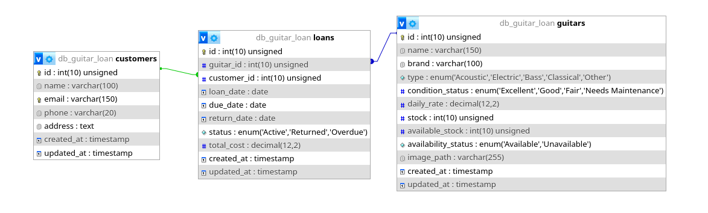

# TP7 DPBO — Guitar Loan (OOP dalam Website PHP dengan GUI)

Tugas Praktikum 7 Mata Kuliah Desain dan Pemrograman Berorientasi Objek (DPBO) — aplikasi web PHP Native dengan konsep **Object-Oriented Programming (OOP)** dan GUI untuk mengelola penyewaan gitar: inventaris gitar, data pelanggan, dan transaksi peminjaman.

## Janji

Saya Nabila Attaya Putri Cahyadi dengan NIM 2508355 mengerjakan Tugas Praktikum 7 pada Mata Kuliah Desain dan Pemrograman Berorientasi Objek (DPBO) untuk keberkahan-Nya maka saya tidak melakukan kecurangan seperti yang telah dispesifikasikan. Aamiin

## Penjelasan Tema

**Guitar Loan** adalah sistem manajemen penyewaan gitar berbasis web PHP Native dengan GUI. Tema ini dipilih sebagai katalog produk + sistem peminjaman alat: toko/studio menyimpan inventaris gitar (model, brand, tipe, kondisi, tarif harian, stok, foto), mendaftarkan pelanggan/penyewa (nama, email, telepon, alamat), dan mencatat transaksi pinjaman (tanggal pinjam, jatuh tempo, tanggal kembali, status, total biaya).

Aturan bisnis utamanya:

- Setiap gitar punya `stock` (total unit) dan `available_stock` (unit siap disewakan); `availability_status` berubah mengikuti sisa stok.
- Membuat pinjaman memotong stok; mengembalikan (`return`) mengembalikannya.
- Pinjaman yang melewati `due_date` otomatis menjadi `Overdue` saat aplikasi dibuka (`checkAndUpdateOverdueLoans()`).
- Dashboard menampilkan statistik (total model, stok tersedia, pelanggan, rental aktif/overdue/return) dan 5 transaksi terbaru.

Tema ini memenuhi spesifikasi TP7: bebas, 3 entitas, dan 1 tabel ber-relasi *foreign key* (`loans` → `guitars`, `customers`), dengan CRUD lengkap per entitas dan query Prepared Statement.

## Struktur Folder

```
TP7DPBO2526C1/
├── README.md
├── documentation/
│   ├── diagram.png
│   ├── dashboard.mp4
│   ├── guitars-crud.mp4
│   ├── customers-crud.mp4
│   └── loans-crud.mp4
└── program/
    ├── index.php
    ├── style.css
    ├── assets/
    │   ├── logo.png
    │   └── guitars/
    │       ├── cordoba-c5-classical.png
    │       ├── cort-d20-acoustic.png
    │       ├── fender-stratocaster-electric.png
    │       ├── gibson-les-paul-electric.png
    │       ├── ibanez-rg421-electric.png
    │       ├── martin-d28-acoustic.png
    │       ├── sire-v7-bass.png
    │       ├── taylor-214ce-acoustic.png
    │       ├── yamaha-cg122ms-classical.png
    │       ├── yamaha-gl1-guitarlele.png
    │       └── yamaha-trbx174-bass.png
    ├── class/
    │   ├── Guitar.php
    │   ├── Customer.php
    │   └── Loan.php
    ├── config/
    │   └── db.php
    ├── database/
    │   └── db_guitar_loan.sql
    └── view/
        ├── header.php
        ├── footer.php
        ├── guitars.php
        ├── customers.php
        └── loans.php
```

## Desain / Fungsi Program

Aplikasi mengikuti alur standar modul: `class/` = Model (satu class per entitas), `config/` = koneksi database, `database/` = file `.sql`, `view/` = komponen HTML modular, `index.php` = titik awal aplikasi (routing + handle POST/GET), `style.css` = styling, dan `assets/` = gambar/logo. Database `db_guitar_loan` terdiri dari 3 entitas dengan relasi *foreign key* pada tabel `loans`. Seluruh query menggunakan **Prepared Statement PDO** (`prepare()` + `execute([...])`), tidak ada query mentah.

**Per-file:**

- `program/index.php` — entry point: start session, include `config/db.php` + ketiga class, buat CSRF token, instansiasi `Database`/`Guitar`/`Customer`/`Loan`, sinkronkan pinjaman lewat jatuh tempo (`checkAndUpdateOverdueLoans()`), tangani POST (create/update/delete/return per halaman), siapkan routing GET (`dashboard`, `guitars`, `customers`, `loans`), tampilkan dashboard dan include view yang sesuai.
- `program/config/db.php` (`Database`) — wrapper koneksi PDO MySQL (`host=db_guitar_loan`, `ERRMODE_EXCEPTION`, `FETCH_ASSOC`, `ATTR_EMULATE_PREPARES=false`).
- `program/class/Guitar.php` (`Guitar`) — model inventaris gitar: baca semua/katalog tersedia/by ID, CRUD, upload/ganti/hapus file gambar, hitung pinjaman aktif.
- `program/class/Customer.php` (`Customer`) — model pelanggan: baca semua/by ID, CRUD, cek duplikat email, hitung pinjaman aktif (satu pelanggan & agregat).
- `program/class/Loan.php` (`Loan`) — model transaksi rental: baca semua dengan `JOIN` gitar + pelanggan/by ID, buat/update/hapus loan, proses return dengan `SELECT ... FOR UPDATE` (kunci baris anti double-submit), auto-update status overdue, sinkron stok `available_stock`/`availability_status`.
- `program/database/db_guitar_loan.sql` — skema + seed data (11 gitar, 10 pelanggan, 10 pinjaman) + `UPDATE` sinkronisasi stok.
- `program/view/header.php` / `footer.php` — komponen header (logo `assets/logo.png`) dan footer yang dipakai ulang di `index.php`.
- `program/view/guitars.php` — halaman inventaris: tabel daftar gitar + form add/edit (nama, brand, tipe, condition, rate, stock, upload gambar) dengan CSRF field.
- `program/view/customers.php` — halaman pelanggan: tabel daftar pelanggan + form add/edit (nama, email, phone, address) dengan CSRF field.
- `program/view/loans.php` — halaman transaksi: tabel daftar pinjaman (gitar/pelanggan/tanggal/status) + form create/edit (pilih gitar & pelanggan, loan/due date, total cost, return) dengan CSRF field.
- `program/style.css` — styling halaman (kartu statistik, tabel, form, badge status, navigasi).
- `program/assets/logo.png`, `program/assets/guitars/*.png` — logo dan foto model gitar (11 file sesuai seed).

**Fungsi tiap komponen**

| Komponen | Fungsi |
|---|---|
| Navigasi + Dashboard | Menu Dashboard/Guitars/Customers/Loans; statistik total model, stok tersedia, pelanggan, rental aktif/overdue/return; tabel 5 transaksi terbaru |
| Form Gitar | Tambah/edit model gitar beserta stok, tarif harian, foto; hapus model |
| Form Pelanggan | Tambah/edit data pelanggan; hapus data pelanggan |
| Form Pinjaman | Buat/edit transaksi rental; tandai return (stok kembali otomatis); hapus transaksi |

**Penjelasan Database (`db_guitar_loan`)**

1. **`guitars`** — inventaris: `id`, `name`, `brand`, `type` ENUM('Acoustic','Electric','Bass','Classical','Other'), `condition_status` ENUM('Excellent','Good','Fair','Needs Maintenance'), `daily_rate` DECIMAL, `stock`, `available_stock`, `availability_status` ENUM('Available','Unavailable'), `image_path`, `created_at`, `updated_at`. Constraint: `daily_rate >= 0`, `available_stock <= stock`.
2. **`customers`** — pelanggan: `id`, `name`, `email` UNIQUE, `phone`, `address`, `created_at`, `updated_at`.
3. **`loans`** — transaksi: `id`, `guitar_id` FK → `guitars(id)`, `customer_id` FK → `customers(id)` (keduanya `ON UPDATE CASCADE ON DELETE RESTRICT`), `loan_date`, `due_date`, `return_date`, `status` ENUM('Active','Returned','Overdue'), `total_cost`, timestamps. Constraint: `due_date >= loan_date`, `total_cost >= 0`.

### Diagram Relasi Database



## Method Program

| Class / File | Method / Fungsi | Fungsi |
|---|---|---|
| `config/db.php:4` (`Database`) | `__construct()` | Buka koneksi PDO ke MySQL; simpan pada properti publik `conn` (`db.php:11`) |
| `class/Guitar.php:7` (`Guitar`) | `__construct(?PDO $db)` | Terima / buat koneksi PDO |
| | `getAllGuitars(): array` | Baca semua gitar (`ORDER BY id`) |
| | `getAvailableGuitars(): array` | Baca gitar dengan `available_stock > 0` untuk dropdown pinjaman |
| | `getGuitarById(int $id): ?array` | Baca satu gitar by ID |
| | `createGuitar(array $data): int` | Tambah gitar; validasi nama/brand & `daily_rate >= 0` |
| | `updateGuitar(int $id, array $data): bool` | Ubah gitar; tolak bila stok < pinjaman aktif |
| | `deleteGuitar(int $id): bool` | Hapus gitar; tolak bila masih dirental / punya riwayat FK |
| | `getActiveLoansCount(int $id): int` | Hitung pinjaman aktif/overdue milik gitar |
| | `handleImageUpload(array $file): ?string` | Validasi MIME JPG/PNG/WEBP/GIF & ≤ 5MB, simpan ke `assets/guitars/` |
| | `deleteImageFile(string $relativePath): void` | Hapus file gambar bila tidak dipakai gitar lain |
| `class/Customer.php:7` (`Customer`) | `__construct(?PDO $db)` | Terima / buat koneksi PDO |
| | `getAllCustomers(): array` | Baca semua pelanggan |
| | `getCustomerById(int $id): ?array` | Baca satu pelanggan by ID |
| | `createCustomer(array $data): int` | Tambah pelanggan; validasi nama/email/phone/address & email unik |
| | `updateCustomer(int $id, array $data): bool` | Ubah pelanggan; validasi sama + cek email unik di luar ID |
| | `deleteCustomer(int $id): bool` | Hapus pelanggan; tolak bila punya pinjaman aktif / riwayat FK |
| | `getActiveLoansCount(int $id): int` | Hitung pinjaman aktif/overdue milik pelanggan |
| | `getActiveLoanCounts(): array` | Agregat pinjaman aktif per `customer_id` |
| | `emailExists(string $email, ?int $excludeId): bool` | Cek keberadaan email (dengan/tanpa exclude ID) |
| `class/Loan.php:9` (`Loan`) | `__construct(?PDO $db)` | Terima / buat koneksi PDO |
| | `getAllLoans(): array` | Baca semua pinjaman + JOIN nama/brand gitar & nama/email/phone pelanggan |
| | `getLoanById(int $id): ?array` | Baca satu pinjaman + JOIN by ID |
| | `createLoan(array $data): int` | Buat pinjaman + potong stok gitar; validasi gitar/pelanggan exist, stok > 0, tanggal & cost |
| | `returnLoan(int $id, ?string $returnDate): bool` | Tandai Returned + kembalikan stok; kunci baris `FOR UPDATE` |
| | `updateLoan(int $id, array $data): bool` | Ubah pinjaman dengan re-sinkron stok bila gitar/status berubah; kunci baris `FOR UPDATE` |
| | `deleteLoan(int $id): bool` | Hapus pinjaman; kembalikan stok bila masih aktif/overdue; kunci baris `FOR UPDATE` |
| | `checkAndUpdateOverdueLoans(): int` | Ubah status Active → Overdue bila `due_date` lewat hari ini |
| `index.php` (fungsi global) | `setFlash(string, string): void` | Simpan pesan flash sukses/gagal di `$_SESSION` |
| | `getFlash(): ?array` | Baca + hapus pesan flash |
| | `csrfField(): string` | Render hidden input CSRF untuk setiap form |
| | `csrfVerify(): void` | Verifikasi token CSRF POST; gagal → redirect + flash danger |

## Penjelasan Flow

1. User membuka `program/index.php` di browser → server PHP menerima GET; `index.php` start session, set timezone `Asia/Jakarta`, buat token CSRF bila belum ada (`index.php:4-21`).
2. `index.php` include `config/db.php` dan ketiga class, buat objek `Database` lalu `Guitar`, `Customer`, `Loan` — bila koneksi gagal, tampilkan `Connection Error` + instruksi import `db_guitar_loan.sql` (`index.php:62-77`).
3. `Loan::checkAndUpdateOverdueLoans()` mengubah pinjaman Active yang lewat `due_date` menjadi Overdue (`index.php:73`).
4. Bila request POST (aksi form), `csrfVerify()` cek token; mismatch → flash `Invalid security token. Please try again.` lalu redirect (`index.php:83-84`).
5. `index.php` route `page` + `action`: guitars → `createGuitar/updateGuitar/deleteGuitar` (plus `handleImageUpload`), customers → `createCustomer/updateCustomer/deleteCustomer`, loans → `createLoan/returnLoan/updateLoan/deleteLoan`; sukses → flash success, error (Exception) → flash danger berisi pesan validasi (`index.php:89-158`).
6. Untuk GET, `index.php` preload data sesuai `page` & `action=edit` (mis. `getGuitarById((int)$_GET['id'])`) lalu include view `guitars.php`/`customers.php`/`loans.php` atau blok dashboard (`index.php:176-206`).
7. Di class Model, setiap query dijalankan via `$this->db->prepare("...")` + `$stmt->execute([...])` dengan placeholder `?` — tidak ada query mentah (`->query()` tanpa prepare tidak dipakai).
8. `Loan::createLoan/returnLoan/updateLoan/deleteLoan` menyesuaikan stok gitar (`available_stock`, `availability_status`) dalam transaksi ber-kunci-baris (`FOR UPDATE`) agar double-submit aman.
9. View menampilkan tabel data (`htmlspecialchars` untuk semua output) dan form (gitar/pelanggan/pinjaman) yang di-POST kembali ke `index.php?page=...` dengan CSRF.
10. Dashboard menghitung `count`/`available_stock`/`Active`/`Overdue`/`Returned` langsung dari data yang dimuat (`index.php:199-204`).

## Validasi / Error Handling

| Bagian | Kondisi tidak valid | Penanganan |
|---|---|---|
| `index.php:83-84,47-53` | Token CSRF POST tidak cocok / hilang | Flash danger `Invalid security token. Please try again.`, redirect ke `index.php` |
| `index.php:63-77` | MySQL tidak jalan / file SQL belum di-import | Tampilkan alert `Connection Error: Database connection error: ...` + pesan import `database/db_guitar_loan.sql` |
| `Customer.php:46-65` | Nama kosong, email tidak valid, phone kosong, address kosong, email duplikat | `InvalidArgumentException`: `Customer name cannot be empty.` / `A valid email address is required.` / `Customer phone number is required.` / `Customer address is required.` / `Email '...' is already registered to another customer.` |
| `Customer.php:86,97-114` | Update/delete ID tidak ditemukan | `InvalidArgumentException`: `Customer with ID {id} not found.` |
| `Customer.php:140,147` | Hapus pelanggan yang masih punya pinjaman aktif / riwayat FK | `RuntimeException`: `Cannot delete customer: customer currently has {n} active rental loan(s).` / `Cannot delete customer with past rental history due to database foreign key constraints.` |
| `Guitar.php:59,64` | Nama/brand kosong, `daily_rate` negatif | `InvalidArgumentException`: `Guitar name and brand are required.` / `Daily rate cannot be negative.` |
| `Guitar.php:102,115-126` | Update ID tidak ditemukan; stok baru < pinjaman aktif | `InvalidArgumentException`: `Guitar with ID {id} not found.` / `Cannot reduce stock to {stock}; {n} unit(s) are currently on active rental loan.` |
| `Guitar.php:178,184,191` | Hapus gitar yang sedang dirental / punya riwayat FK | `RuntimeException`: `Cannot delete guitar: {n} unit(s) are currently rented out. Please complete or return the loans first.` / `Cannot delete guitar with rental history because database foreign key constraints protect past transaction records.` |
| `Guitar.php:227,232,249,265` | Upload gagal, gambar > 5MB, MIME bukan JPG/PNG/WEBP/GIF, gagal simpan | `RuntimeException`/`InvalidArgumentException`: `File upload failed with error code: {code}` / `Guitar image exceeds the 5MB size limit.` / `Invalid file type ({mime}). Only JPG, PNG, WEBP, and GIF images are allowed.` / `Failed to save uploaded image to destination directory.` |
| `Loan.php:84-117` | Gitar/pelanggan tidak valid, cost negatif, tanggal kosong, due < loan, gitar tidak ada / stok habis, pelanggan tidak ada | `InvalidArgumentException`/`RuntimeException`: `Please select a valid guitar and customer.` / `Total cost cannot be negative.` / `Loan date and due date are required.` / `Due date cannot be earlier than the loan date.` / `Selected guitar does not exist.` / `Selected guitar is currently out of stock or unavailable.` / `Selected customer does not exist.` |
| `Loan.php:152,182,187,229-331,381` | Gagal alokasi stok (race), ID loan tidak ditemukan, loan sudah Returned, status invalid, target gitar/pelanggan tidak ada, re-aktivasi/ganti gitar tanpa stok | `RuntimeException`/`InvalidArgumentException`: `Failed to allocate guitar stock; guitar may have just become unavailable.` / `Loan transaction with ID {id} not found.` / `This loan has already been marked as returned.` / `Invalid loan status.` / `Target guitar does not exist.` / `Target customer does not exist.` / `Cannot reactivate loan: guitar has no available stock.` / `Cannot switch to new guitar: guitar has no available stock.` |

Semua exception dari class Model ditangkap di `index.php:153-158` → disimpan sebagai flash danger dan ditampilkan sebagai alert tanpa menambah data.

## Dokumentasi Saat Program Dijalankan

- **Dashboard** — ringkasan statistik dan 5 transaksi terbaru:

  [documentation/dashboard.mp4](documentation/dashboard.mp4)

- **Guitars CRUD** — tambah, edit, dan hapus inventaris gitar:

  [documentation/guitars-crud.mp4](documentation/guitars-crud.mp4)

- **Customers CRUD** — tambah, edit, dan hapus data pelanggan:

  [documentation/customers-crud.mp4](documentation/customers-crud.mp4)

- **Loans CRUD** — buat, edit, hapus, dan return pinjaman gitar:

  [documentation/loans-crud.mp4](documentation/loans-crud.mp4)
